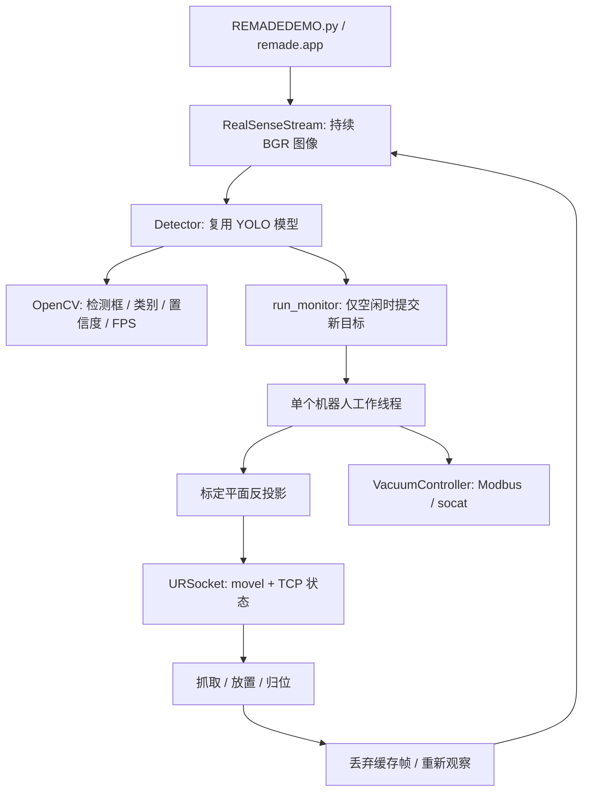

# 架构与数据流

## 运行时组成



主线程拥有相机、推理和 GUI。机器人工作线程拥有串行的归位、抓取、放置流程。最多存在一个未完成任务，没有堆积旧检测结果的队列。程序不追求操作系统级硬实时；显示 FPS 是包含采集和推理的实际循环速率。

工作线程结束后，主线程先读取任务结果；失败则退出，不提交下一次分拣。成功则清空相机当前缓存，重新读取图像。若工作线程恰好在当前帧推理期间完成，该帧仍不能触发下一任务，直到下一循环确认完成。

## 核心数据契约

| 数据 | 结构 | 单位/约定 |
|---|---|---|
| 图像 | H×W×3 NumPy `uint8` | BGR；标定分辨率 1920×1080 |
| 检测目标 | N×3 | `[class_id, center_u, center_v]`，中心为原图像素 |
| TCP 位姿 | 长度 6 | `[x,y,z,rx,ry,rz]`，米 + 旋转向量弧度 |
| 抓取序列 | N×7 | `[class_id,x,y,z,rx,ry,rz]` |
| 关节轨迹（历史） | 逐个 6 关节点 | 弧度；当前主入口不加载这些文件 |
| 真空命令 | 两个 Modbus 寄存器 | 同时控制 A/B 通道；应答表示命令接受 |

Detector 读取 `boxes.xywh` 的像素中心，避免旧脚本通过固定 1920/1080 再缩放归一化坐标。当前仍固定采集分辨率，因为内参来自该分辨率的原标定。

## 坐标变换

设 B 为机器人基座、T 为 TCP、C 为相机、W 为工作台标定坐标。沿用旧代码矩阵和乘法顺序：

```text
T_CW = inverse(T_TC) × inverse(T_BT) × T_BW
```

`T_BT` 的旋转由机器人旋转向量通过 Rodrigues 公式得到，平移从米转成毫米。`TCP_CAMERA` 和 `BASE_CALIBRATION` 的平移均为毫米。

给定像素 `[u,v]`，通过内参矩阵和 `T_CW` 的旋转/平移求射线与 W 坐标系 `z=0` 平面的交点，再用 `T_BW` 转回基座，最后除以 1000 转为米。与原脚本一致，目标 z 和姿态不是物体实测高度/角度，而是抓取流程指定的固定值。

`geometry.py` 对零旋转、等价的 ±π 旋转、平行射线、非有限输入和相机背面的交点做了处理。原标定矩阵并非严格正交的理想旋转矩阵，当前保持原始数据，不擅自重新标定。

## 单部件动作

选择首个已知类别 → 读取静止时 TCP → 计算目标 XY → 到目标上方 z=0.15 → 开真空 → 下降至 z=-0.005 → 抬升至 z=0.15 → 到分类工位上方 z=0.2 → 下降至 z=0.1 → 确认到位 → 释放 → 抬升 → 归位。

这些高度是原实验工位参数，含有相对机器人基座的负值，不是通用设备设置。类别 0/1/3 使用低价值工位，2/4 使用高价值工位。当前没有自动翻转、掩码朝向估计、抓取成功检测或避障规划。

## 退出与故障

Q、Esc、关闭窗口、Ctrl+C 或错误会设置共享停止事件。运动等待和新动作入口检查停止事件；退出清理向控制连接发送 `stopl`，关闭机器人连接和真空串口，终止本次启动的桥接进程，再关闭相机和窗口。退出时不会主动释放可能在途的工件。网络或设备故障可能使软件停止命令无法送达，现场急停仍由设备承担。

相机/模型启动失败时清理已经创建的资源。推理和 Modbus 调用是阻塞的边界，退出响应受其耗时、设备超时和机器人工作线程结束时间影响。
