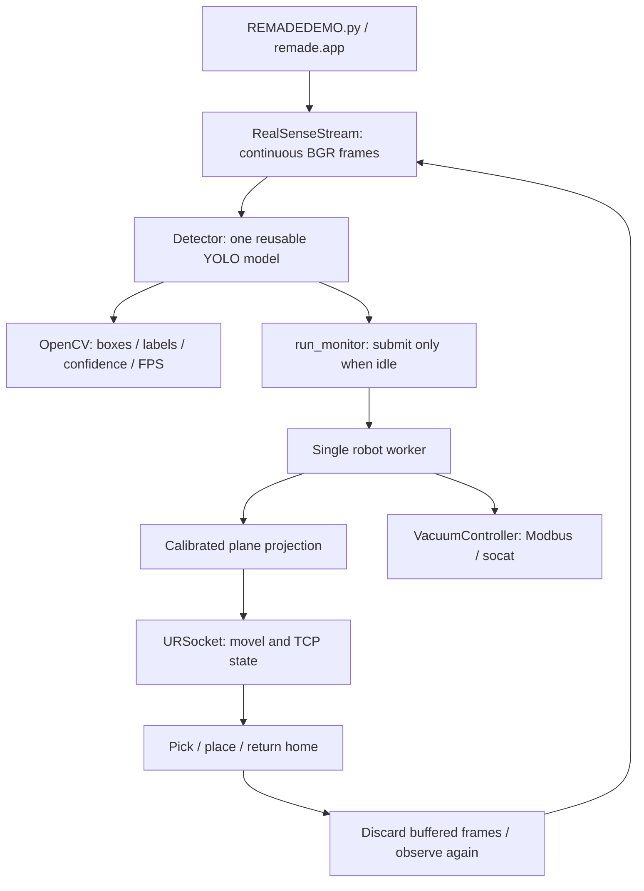

# Architecture and data flow

## Runtime components



The main thread owns capture, inference and the GUI. One worker serializes robot startup, picking and placement. At most one robot task is outstanding; detections do not accumulate in a queue. Displayed FPS measures the actual capture/inference/display loop, without an operating-system hard-real-time guarantee.

When the worker completes, the main thread first retrieves its result. Failure ends the session. Success discards buffered camera frames before the next observation. A frame whose inference overlaps worker completion cannot start another task: readiness is established before capture.

## Data contracts

| Data | Shape | Units and conventions |
|---|---|---|
| Image | H x W x 3 NumPy uint8 | BGR; calibrated capture size 1920 x 1080 |
| Detection targets | N x 3 | [class_id, center_u, center_v] in original-image pixels |
| TCP pose | Six values | [x,y,z,rx,ry,rz], metres and rotation-vector radians |
| Pick targets | N x 7 | [class_id,x,y,z,rx,ry,rz] |
| Historical joint trajectories | Six joint values per waypoint | Radians; not loaded by the maintained entry point |
| Vacuum command | Two Modbus registers | Channels A and B together; acknowledgement does not prove a successful grasp |

The detector uses pixel centres from `boxes.xywh`. The old scripts rescaled normalized coordinates using fixed dimensions. Capture remains fixed at 1920 x 1080 because the retained intrinsics apply to that resolution.

## Coordinate transforms

Let B be the robot base, T the TCP, C the camera and W the calibrated worktable. The original matrices and multiplication order are retained:

```text
T_CW = inverse(T_TC) x inverse(T_BT) x T_BW
```

The rotation in T_BT comes from the robot rotation vector through Rodrigues' formula; its translation is converted from metres to millimetres. Translations in TCP_CAMERA and BASE_CALIBRATION are also in millimetres.

For pixel [u,v], the intrinsics and T_CW define a ray. Its intersection with W's z=0 plane is transformed back to B using T_BW, then divided by 1000 to obtain metres. Target height and orientation are fixed by the pick sequence; they are not measured object height or mask orientation.

`geometry.py` handles zero rotation, equivalent positive/negative pi rotations, parallel rays, non-finite inputs and intersections behind the camera. The original calibration matrices are not perfectly orthogonal rotations. They remain unchanged; no replacement calibration is inferred.

## One-component sequence

Select the first supported class, read TCP state, calculate target XY, approach at z=0.15, enable vacuum, descend to z=-0.005, lift to z=0.15, approach the destination at z=0.2, descend to z=0.1, confirm arrival, release, lift and return home.

These heights are laboratory-specific base-frame coordinates, including a negative z. Classes 0/1/3 go to the low-value station; 2/4 go to the high-value station. Automatic flipping, mask-derived orientation, grasp confirmation and collision planning are not integrated.

## Shutdown and faults

Q, Esc, window closure, Ctrl+C or a runtime error sets the shared stop event. Motion waits and new action boundaries check it. Motion errors attempt stopl immediately from the worker. Cleanup stops the robot, closes its connection and the vacuum serial client, terminates only this session's bridge process, then closes the camera and window. Shutdown does not actively release a potentially held component.

Startup errors close resources already created. Inference and Modbus are blocking boundaries, so shutdown latency depends on those calls, device timeouts and worker termination. A disconnected controller may not receive a software stop; physical emergency-stop handling belongs to the equipment.
