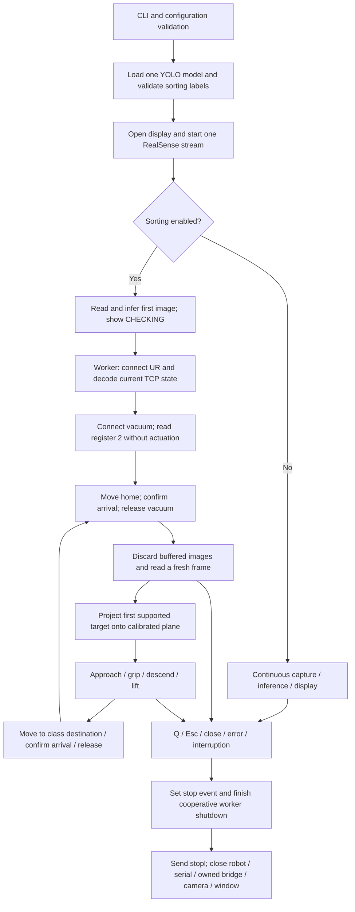

# Complete connection workflow

The maintained application connects the camera, detector, display, robot and vacuum controller through one explicit lifecycle. The default mode opens only vision resources. Sorting is enabled with --sort.

## Launch to shutdown



The main thread keeps capture, inference and display running while the worker prepares connections and executes motion. The first preparation image verifies vision only; it is discarded for target selection. Before the first movel, camera acquisition, inference, display, robot state decoding and a vacuum register read must all succeed.

Initial homing is followed by a release command, retaining the original DEMO's empty-gripper startup behaviour. Begin a sorting session with an empty gripper. Read-only preparation itself neither moves the robot nor changes vacuum output. It cannot establish collision clearance or verify that a component is held.

## Interfaces and ownership

| Boundary | Protocol/configuration | Owning component | Failure handling |
|---|---|---|---|
| CLI to application | Python arguments; checkpoint path and numeric validation | app.main | Reject invalid input before device startup |
| Camera to application | RealSense colour, BGR8, 1920 x 1080, requested 30 FPS | RealSenseStream/main thread | Frame timeout or missing colour frame ends the session |
| Image to detections | One Ultralytics model; original-pixel centres and class IDs | Detector/main thread | First inference must pass before sorting startup; later failures stop work |
| Main loop to worker | One future; copied target array; no queued batches | run_monitor | Retrieve worker errors before submitting another task |
| Application to UR | TCP host:30003; URScript movel/stopl; binary TCP-state stream | URSocket/worker | Absolute packet deadline, motion deadline, finite-value validation, immediate stop attempt on motion error |
| Application to VGC10 | Modbus RTU, unit 65, 115200 baud, 8 data bits, even parity, one stop bit | VacuumController/worker | Check connect and protocol response; failures stop the sequence |
| Automatic serial bridge | Linux socat, local PTY to robot host:54321 | VacuumController | Own only this process and temporary directory; close both on exit |
| Existing serial interface | --serial-device, bypasses socat | VacuumController | Same Modbus contract; no automatic TCP forwarding |
| Display to shutdown | Q, Esc, window closure or exception | Main thread/shared Event | Stop new jobs, wait for worker, then close resources |

The robot address defaults to 10.125.145.89. TCP ports and deadlines are defined in Settings; they are not discovered automatically. Port 30003 decoding uses the original controller's pose layout, bytes 444 through 491 of a framed packet. Confirm that layout for the installed firmware.

The vacuum startup read uses holding register 2 (current limit), count 1, unit 65, following the archived controller interface. It validates communication and response shape without changing the current limit. Grip writes [316,316] at address 0 for 60%; release writes [0,0]. This is command acknowledgement, not measured suction.

## Coordinate and action chain

A fresh image produces rows [class_id,u,v]. The worker obtains the current six-value TCP pose, converts its translation from metres to millimetres, applies the retained hand-eye/worktable transforms and intersects the pixel ray with the calibrated z=0 plane. Base coordinates return to metres before URScript generation.

Only the first supported target is selected. Classes 0/1/3 use LOW_BIN; 2/4 use HIGH_BIN. Every move waits for position/orientation arrival. Vacuum starts after the approach and before descent. Destination release occurs only after arrival at z=0.1. The arm then lifts and returns home. The next target requires a new observation after buffered frames are discarded.

On a rejected grip command, the worker never sends the subsequent descent. On shutdown, no additional release is sent; cleanup preserves any held-part state. A software stop remains dependent on the controller connection.

## Reproducible software verification

```bash
python -m pip install -r requirements-test.txt
python -m unittest discover -s tests -v
python tools/check_repository.py
```

[test_workflow.py](../tests/test_workflow.py) invokes the real app.main, RealSenseStream, Detector, OpenCVDisplay, run_monitor, geometry, Sorter, URSocket packet decoder and VacuumController. Only the SDK/model/device boundaries are simulated. No physical network, camera, serial port, checkpoint deserialization or real GUI is used.

| Scenario | Asserted outcome |
|---|---|
| Each of five classes | Correct destination, metric coordinates, complete pick/place/home sequence and acknowledgement before release |
| Initial image with a different class/location | Preparation observation never becomes a pick target |
| Gripper command held pending | Three additional displayed frames while the real worker remains busy |
| Camera, inference, robot-state or vacuum-preparation failure | No movel or vacuum release; all opened resources close |
| Grip command rejected | No descent and no release during cleanup |
| Monitor-only mode | Repeated frames with zero robot/serial connections |
| Successful cycle | One camera start, one model load, one robot connection, one serial connection; buffers discarded after worker completion |
| Fragmented telemetry | Full packets decoded through the actual transport code |
| Q after completion | Stop command and exactly-once camera/window cleanup |

Additional regressions cover shutdown interruption, an absolute packet deadline, no queued stale batches, rotation singularities, model-label mismatch and cross-platform index ordering. GitHub Actions repeats offline checks on Python 3.10, 3.11 and 3.12.

## Repository and physical handoff

Clone [ChangChrisLiu/REMADE](https://github.com/ChangChrisLiu/REMADE), install runtime requirements, run monitoring first, then use --sort on the calibrated laboratory system. Reference snapshots are ordinary tracked files, so no submodule initialization is required. The model and documented assets are included and hash-checked. Local documentation links and the generated source index are checked in CI.

This verifies software wiring under simulated boundaries. Hardware connectivity, firmware packet compatibility, calibration, clearance, achieved vacuum, model accuracy and measured frame latency require equipment-based commissioning. See [operations](OPERATIONS.md), [architecture](ARCHITECTURE.md) and [review limits](CODE_REVIEW.md).
